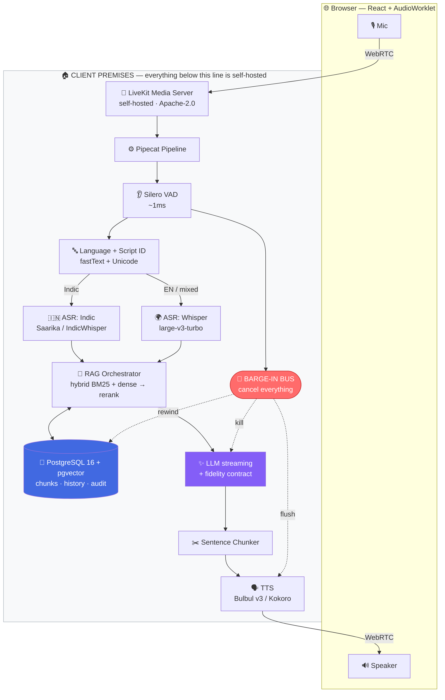

<div align="center">

# 🕉️ BHASHA

### **B**ilingual **H**inglish-**A**ware **S**peech-to-speech **H**istorical **A**ssistant

*Bol jo bhi bhasha ho — jawab usi mein aayega.*

A self-hostable, real-time voice agent that speaks Hindi, English, Hinglish, or a regional Indian language — and answers **only** from a cited knowledge base of Indian history.

<br>


<br>

🏛️ **Poornima Institute of Engineering & Technology** · Department of Computer Engineering
🎓 Final Year Project 2026–27 · **Team Oblivion**
👩‍🏫 Guide: **Dr. Aashima Tiwari**, Associate Professor

</div>

---

## 🧭 Contents

| | | |
|---|---|---|
| [🎯 The Pitch](#-the-pitch) | [🚫 Why The Obvious Way Fails](#-why-the-obvious-way-fails) | [🏛️ The Four Pillars](#️-the-four-pillars) |
| [🗺️ Architecture](#️-architecture) | [⚡ Latency Budget](#-latency-budget) | [🧰 Tech Stack](#-tech-stack) |
| [📦 Deployment Profiles](#-deployment-profiles--the-client-story) | [🚀 Quickstart](#-quickstart) | [🧪 Test Data & Evaluation](#-test-data--evaluation) |
| [📂 Repo Layout](#-repository-layout) | [⚠️ Risks](#️-known-risks--mitigations) | [🗓️ Execution Plan](#️-execution-plan) |
| [👥 Team](#-team) | [📜 Licensing](#-acknowledgements--licensing) | |

---

## 🎯 The Pitch

> Every voice-assistant demo is `Whisper → GPT → TTS`. **BHASHA is different in four measurable ways.**

<table>
<tr>
<td width="25%" align="center">

### 🔀
**Routes**

Picks the ASR engine by detected language instead of forcing one model to do everything

</td>
<td width="25%" align="center">

### 🔒
**Guarantees**

Replies in the *same language **and script*** you spoke — Hinglish in, Hinglish out

</td>
<td width="25%" align="center">

### 📚
**Grounds**

Every claim traces to a source chunk, so hallucination becomes a **number**

</td>
<td width="25%" align="center">

### 🏠
**Ships**

One Compose file. Runs fully air-gapped inside a client's network

</td>
</tr>
</table>

---

## 🚫 Why The Obvious Way Fails

| 💭 The assumption | 💥 What actually happens |
|---|---|
| *"Whisper does 99 languages, so multilingual is solved."* | It collapses code-mixed Hinglish into a single script and **drops the switch points**. It also trails Indic-specialised models on Marathi, Bengali and Tamil. |
| *"The LLM will just reply in whatever language the user used."* | It won't. Ask in romanised Hinglish and models routinely answer in Devanagari, then drift to pure English by turn three. |
| *"PostgreSQL stores the conversation, so we have memory."* | **Storage ≠ retrieval.** Without grounding, the system is an API wrapper with zero technical contribution. |
| *"Accuracy improved."* | Against what baseline? On what test set? Measured how? |

BHASHA is engineered to survive **every one** of those viva questions.

---

## 🏛️ The Four Pillars

<details open>
<summary><b>🔀 Pillar 1 — Dual-Path ASR with a Language Router</b></summary>

<br>

Audio hits a fast language-identification pass **first**. Indic-dominant speech routes to an Indic-first recogniser; English and code-mixed speech routes to Whisper Large v3 Turbo.

> 🧠 One model for everything is a compromise. Two models plus a router is an **architecture**.

</details>

<details open>
<summary><b>🔒 Pillar 2 — The Language Fidelity Contract</b> ⭐ <i>core contribution</i></summary>

<br>

The system detects **language *and* script**, pins both into a contract, constrains generation to it, then **validates the output against it** and repairs on violation.

```python
contract = {"lang": "hi-en", "script": "Latn", "register": "casual"}

# 1️⃣ DETECT    — fastText lid.176 + Unicode block histogram over the transcript
# 2️⃣ CONSTRAIN — inject the contract into the system prompt, every turn, no exceptions
# 3️⃣ VALIDATE  — re-run script detection over the generated text
#                 if devanagari_ratio > 0.15 and contract.script == "Latn" → 🚨 violation
# 4️⃣ REPAIR    — one transliteration-and-retry pass before text reaches TTS
```

This is what turns *"the bot sometimes replies in the wrong language"* from an anecdote into a metric: **Language Fidelity Rate (LFR)**, reported per flavour in [§ Evaluation](#-test-data--evaluation).

</details>

<details open>
<summary><b>📚 Pillar 3 — Cross-Lingual Grounded Retrieval</b></summary>

<br>

The corpus is **English** Wikipedia. The user speaks **Hinglish**. Multilingual embeddings put both in one vector space, so a Hindi question retrieves English passages and the answer comes back in Hindi **with citations**.

```
🎙️ "Ashoka ne Kalinga ke baad kya kiya?"
      ↓ BGE-M3 embedding (language-agnostic space)
📄 retrieves → Ashoka > Kalinga War > Aftermath  [en]
      ↓ generation under fidelity contract
🔊 "Kalinga War ke baad unhone violence chhod diya aur Buddhism apnaya."
   📎 source: Ashoka § Kalinga War > Aftermath
```

</details>

<details open>
<summary><b>🎤 Pillar 4 — True Barge-In</b></summary>

<br>

The user can interrupt mid-sentence. This is **not** "stop the speaker". It requires:

- ❌ cancelling the in-flight LLM token stream
- 🚽 flushing the TTS queue
- ⏪ **rewinding conversation state to what was actually spoken aloud**, not what was generated

> ⚠️ Skipping that third step is the most common bug in voice agents — and it corrupts context within three turns.

</details>

---

## 🗺️ Architecture



> 🔑 **One design rule governs everything:** each stage sits behind an abstract interface selected at runtime by an env var. Swapping the TTS vendor is a *config* change, never a code change. That rule is what makes the deployment profiles below possible.

---

## ⚡ Latency Budget

🎯 **Target: time-to-first-audio (TTFA) under 700 ms** on the `hybrid` profile.
Reference open-source builds on this exact pipeline shape reach **165 ms** TTFA on a dedicated GPU — so the target has real headroom.

| | Stage | Budget | Notes |
|---|---|---|---|
| 👂 | Silero VAD end-of-turn | `~1 ms` | Finalise on 600 ms trailing silence — beats fixed timers and raw amplitude thresholds |
| 🔤 | Language + script ID | `~5 ms` | fastText on CPU, runs on the partial transcript |
| 📝 | ASR (Whisper Turbo) | `55–150 ms` | Turbo's 4-layer decoder replaces Large v3's 32 → ~48% faster for a small WER cost |
| 🔎 | Embed + hybrid retrieval | `~40 ms` | pgvector HNSW index |
| 🏅 | Rerank (top-20 → top-5) | `~25 ms` | `bge-reranker-v2-m3` |
| ✨ | LLM → first clause | `~150 ms` | Streaming — we never wait for the full response |
| 🗣️ | TTS first chunk | `50–120 ms` | Sentence-chunked so audio starts before generation ends |
| 🏁 | **TTFA total** | **`~330–500 ms`** | 🚨 Barge-in cancels the whole chain in **< 50 ms** |

---

## 🧰 Tech Stack

| | Layer | ✅ Choice | 💡 Why this, not the obvious alternative |
|---|---|---|---|
| ⚙️ | **Orchestration** | **Pipecat** *(Python, BSD-2)* | Models the agent as swappable frame processors; hit **v1.0 in April 2026** with the widest plugin library. Beats hand-rolling an async loop. |
| 📡 | **Transport** | **LiveKit**, self-hosted *(Apache-2.0)* | Pipecat's default partner is **Daily — hosted SaaS**, unusable inside a client's private network. We run Pipecat's pipeline *on* LiveKit's transport. |
| 👂 | **VAD / turn-taking** | **Silero VAD** | ~1 ms on CPU. Energy thresholds break the moment the room has a ceiling fan. |
| 📝 | **ASR — EN / Hinglish** | Whisper `large-v3-turbo` *(Groq or local `faster-whisper` INT8)* | Groq's free tier gives **2,000 req/day + 28,800 audio-sec/day at 228× real-time** — enough to build the whole project for ₹0. |
| 🇮🇳 | **ASR — Indic** | Sarvam **Saarika** *(API)* / AI4Bharat **IndicWhisper** *(local)* | Saarika does auto language detection **and** transcribe-plus-translate in one call at ~₹30/hr. IndicWhisper is the air-gapped twin. |
| 🔤 | **Language + script ID** | fastText `lid.176` + Unicode histogram | Language alone is useless here — Hinglish and Hindi share a language ID but differ in **script**. Script is what the contract runs on. |
| ✨ | **LLM** | Groq *(Llama 4 Scout / GPT-OSS 120B)* · local **vLLM / Ollama + Qwen3-4B** | Groq for dev speed, local for air-gapped delivery. Identical interface. |
| 🧬 | **Embeddings** | **BGE-M3** | Multilingual **and** emits dense + sparse from one model → hybrid retrieval without running two. |
| 🏅 | **Reranker** | `bge-reranker-v2-m3` | Cross-lingual reranking is where cross-lingual RAG is won or lost. |
| 🐘 | **Store** | **PostgreSQL 16 + pgvector** | One DB for chunks, embeddings, history and audit logs. A separate vector DB is one more service the client inherits, for no gain at our scale. |
| 🗣️ | **TTS** | Sarvam **Bulbul v3** *(API)* · **Kokoro-82M** *(local)* | Bulbul v3 covers **11 Indian languages, 30+ voices**, built for code-mixed Hinglish, ~₹30 / 10k chars. ⛔ **Never Piper** — archived Oct 2025. |
| 🚀 | **Backend** | FastAPI + WebSockets | |
| 🎨 | **Frontend** | React 18 + Vite + **AudioWorklet** | AudioWorklet, *not* the deprecated ScriptProcessorNode. |
| 📊 | **Observability** | OpenTelemetry + self-hosted Langfuse | Per-stage traces. Without them, *"it feels slow"* is unactionable. |
| 🧪 | **Evaluation** | RAGAS + custom LFR + WER/CER | See [§ Evaluation](#-test-data--evaluation). |
| 📦 | **Packaging** | Docker Compose profiles | See [§ Deployment](#-deployment-profiles--the-client-story). |

<details>
<summary>⛔ <b>Explicitly rejected — and why</b></summary>

<br>

| Rejected | Reason |
|---|---|
| 🚫 **Daily** | SaaS-only transport — cannot go inside a client network |
| 🚫 **Piper TTS** | Archived October 2025. Do not build on a read-only repo. |
| 🚫 **ElevenLabs** | Expensive, and weak on Indic pronunciation |
| 🚫 **OpenAI TTS** | No meaningful Indic support |
| 🚫 **FAISS as primary store** | pgvector consolidates it into a DB we already run |
| 🚫 **Standalone vector DB** | Operational overhead the client would inherit for zero benefit |

</details>

---

## 📦 Deployment Profiles — The Client Story

The **same codebase** ships three ways. The client picks one at install time via `BHASHA_PROFILE`.

| | ☁️ `cloud` | ⚖️ `hybrid` 🏆 *recommended* | 🔐 `onprem` |
|---|---|---|---|
| 📝 **ASR** | Groq + Sarvam API | local faster-whisper | local faster-whisper + IndicWhisper |
| ✨ **LLM** | Groq API | Groq API | local vLLM / Ollama |
| 🗣️ **TTS** | Sarvam Bulbul v3 | Sarvam Bulbul v3 | local Kokoro-82M |
| 🎙️ **Audio leaves premises** | ✅ yes | ❌ **no** | ❌ **no** |
| 📄 **Text leaves premises** | ✅ yes | ✅ yes | ❌ **no** |
| 💻 **Hardware needed** | none | 8 GB VRAM | 16–24 GB VRAM |
| ⚡ **TTFA** | ~400 ms | ~450 ms | ~700 ms |
| 💰 **Cost / 1,000 conversations** | ~₹900 | ~₹600 | **₹0** + electricity |

> 🏆 **`onprem` is the differentiator in a client conversation.** A government department, a university, or a healthcare provider *cannot* send citizen audio to a third-party API. Most competing products can't offer that option at all.

---

## 🚀 Quickstart

```bash
# 1️⃣  Clone and configure
git clone <repo> && cd bhasha
cp .env.example .env              # set BHASHA_PROFILE + API keys

# 2️⃣  Bring up the stack
docker compose --profile hybrid up -d

# 3️⃣  Build the knowledge base
python scripts/build_corpus.py    # 📥 fetch + section-aware chunk Wikipedia
python scripts/index_corpus.py    # 🧬 embed → pgvector

# 4️⃣  Talk to it
open https://localhost:8443
```

> 🔐 Microphone access requires **HTTPS**. Compose ships a Caddy sidecar that terminates TLS with a self-signed cert for LAN deployment.

---

## 🧪 Test Data & Evaluation

### 📚 Knowledge Corpus

`data/corpus_articles.txt` → **~80 curated English Wikipedia articles**, Indus Valley Civilisation through the Constitution of India, grouped by era.

`scripts/build_corpus.py` fetches them, drops non-factual sections (References, See also, External links), and performs **section-aware chunking**:

| Setting | Value |
|---|---|
| 📏 Chunk size | 512 tokens |
| 🔗 Overlap | 64 tokens, sentence-aligned |
| 🍞 Metadata preserved | `Ashoka > Kalinga War > Aftermath` |
| 📦 Expected output | ~4,000–6,000 chunks |
| 🔖 Reproducibility | `revision_id` + `fetched_at` pinned per chunk |

> 💡 Character-count chunking destroys the heading breadcrumb — which is the single most useful retrieval metadata Wikipedia gives us. That's why we chunk on sections instead.

### 🎯 Golden Evaluation Set

`data/golden_set.jsonl` → **50 hand-written questions**, gold answers, gold source articles, deliberately stratified:

| | Flavour | n | What it tests |
|---|---|:-:|---|
| 🇬🇧 | Pure English | 10 | Baseline |
| 🇮🇳 | Pure Hindi (Devanagari) | 10 | Cross-lingual retrieval |
| 🔀 | Hinglish (Roman script) | 10 | ⭐ The hard case — ASR **and** script fidelity |
| 🧩 | Hindi script + English terms | 10 | Register preservation |
| 🗺️ | Regional (मराठी / বাংলা / தமிழ்) | 6 | Indic routing + cross-lingual generation |
| ⚡ | Mid-sentence code-switching | 1 | Intra-sentential switching |
| 🚧 | Out-of-scope | 2 | Refusal without falling back to parametric memory |
| 🔁 | Multi-turn coreference | 1 | State across turns **and** languages |

<details>
<summary>🪤 <b>The traps — why 6 of these 50 matter most</b></summary>

<br>

**4 false-premise traps.** Example:

> ❓ *"What role did Ashoka play in the Battle of Plassey?"*

Ashoka ruled in the 3rd century **BCE**. Plassey was **1757 CE**. A system that answers this fluently is hallucinating — and the trap catches it.

**2 out-of-scope probes.** Example:

> ❓ *"Aaj ka cricket match ka score kya hai?"*

Must refuse — **and refuse in Hinglish**, not English. This catches the second failure mode: answering from the model's own memory instead of the corpus.

</details>

### 📊 Metrics

| | Metric | Definition | 🎯 Target |
|---|---|---|---|
| 📝 | **WER / CER** | Word / char error rate per language flavour | `< 15%` Hinglish · `< 10%` English |
| 🔒 | **Language Fidelity Rate** | % of replies matching the contract on **both** language and script | `> 95%` |
| 📚 | **Faithfulness** | RAGAS — claims supported by retrieved context | `> 0.90` |
| 🎯 | **Answer relevance** | RAGAS | `> 0.85` |
| 🔎 | **Context recall@5** | Gold article in top-5 retrieved chunks | `> 0.90` |
| 🪤 | **False-premise rejection** | Traps correctly refused | `4 / 4` |
| 🚧 | **Out-of-scope refusal** | Refused **in the user's own language** | `2 / 2` |
| ⚡ | **TTFA p50 / p95** | Time to first audio byte | `< 700 ms` / `< 1200 ms` |
| 🎤 | **Barge-in latency** | Interrupt → silence | `< 100 ms` |

> 📈 **Report everything as an ablation:** single-ASR vs routed · no-contract vs contract · no-RAG vs RAG vs RAG+rerank.
> **The deltas are the project's actual result — not the absolute numbers.**

---

## 📂 Repository Layout

```
bhasha/
├── 🐳 docker-compose.yml          # ✅ profiles: cloud | hybrid | onprem
├── 🔑 .env.example                # ✅ every var in CLAUDE.md §5
├── 🖥️ server/
│   ├── main.py                    # ✅ FastAPI /health (LiveKit token: M3)
│   ├── config.py                  # ✅ pydantic-settings + profile resolution
│   ├── pipeline.py                # Pipecat pipeline assembly
│   ├── barge_in.py                # 🚨 cancellation bus + state rewind
│   ├── 🔌 providers/              # ← the abstraction layer
│   │   ├── base.py                # ✅ ASRProvider · LLMProvider · TTSProvider · EmbeddingProvider · RerankProvider
│   │   ├── embed_cohere.py        # ✅ embed-multilingual-v3.0 (default)
│   │   ├── embed_local.py         # ✅ bge-m3 (onprem fallback)
│   │   ├── rerank_cohere.py       # ✅ rerank-multilingual-v3.0 (default)
│   │   ├── rerank_local.py        # ✅ bge-reranker-v2-m3 (onprem fallback)
│   │   ├── factory.py             # ✅ resolves EMBED_PROVIDER/RERANK_PROVIDER once (C1)
│   │   ├── asr_groq.py  asr_sarvam.py  asr_local.py
│   │   ├── llm_groq.py  llm_ollama.py
│   │   └── tts_sarvam.py  tts_kokoro.py
│   ├── 🔤 lang/
│   │   ├── detect.py              # fastText + Unicode block histogram
│   │   └── contract.py            # ⭐ detect → constrain → validate → repair
│   └── 🧠 rag/
│       ├── retrieve.py            # ✅ hybrid BM25 + dense, then rerank
│       ├── prompt.py              # ⬜ citation-forced answer template
│       └── schema.sql             # ✅ chunks (pgvector+HNSW+tsv), conversations, turns
├── 🎨 web/                        # React + Vite + AudioWorklet
├── 🛠️ scripts/
│   ├── build_corpus.py            # ✅ implemented + tested
│   ├── index_corpus.py            # ✅ embed → pgvector
│   ├── eval_retrieval.py          # ✅ recall@5 per flavour
│   └── evaluate.py                # ⬜ runs golden_set.jsonl → metrics table
├── 📊 data/
│   ├── corpus_articles.txt        # ✅ 80 curated articles
│   ├── corpus.jsonl               # 🔄 generated
│   └── golden_set.jsonl           # ✅ 50 stratified questions
└── 📖 docs/
    └── architecture.md
```

---

## ⚠️ Known Risks & Mitigations

| | Risk | 🛡️ Mitigation |
|---|---|---|
| 👻 | Whisper hallucinates text during silence | Minimum audio-energy gate + no-speech threshold; VAD-gated input, never fixed-duration recording |
| 🔌 | Sarvam API unreachable at the client site | Provider abstraction auto-falls back to local; `onprem` has **zero** external dependencies |
| ✍️ | Hinglish ground truth is subjective | Score **CER not WER** for Hinglish; all three members annotate a 20-question overlap → report inter-annotator agreement |
| 🗣️ | Regional TTS quality varies by language | Sarvam publishes per-language voice recommendations — we pin the recommended voice and document it |
| 📉 | Free-tier rate limits during the demo | Pre-warm a local `hybrid` instance as live fallback. **Never demo on a free tier.** |
| 📝 | Wikipedia edits drift the corpus | `revision_id` pinned per chunk; the evaluated snapshot is frozen and archived |

---

## 🗓️ Execution Plan

| | Phase | Weeks | 📦 Deliverable | 👤 Owner |
|:-:|---|:-:|---|---|
| 0️⃣ | 🧱 Foundation | 1–2 | Compose stack up, Postgres + pgvector, corpus built and indexed | All |
| 1️⃣ | 🔎 Retrieval | 3–5 | Hybrid retrieval + reranking, context-recall baseline measured | **Daksh** |
| 2️⃣ | 🎙️ Voice loop | 4–7 | LiveKit + Pipecat + VAD + ASR + TTS, turn-based end-to-end | **Arpit** |
| 3️⃣ | 🔒 Fidelity contract | 6–8 | detect → constrain → validate → repair, LFR measured | **Daksh** |
| 4️⃣ | ⚡ Streaming + barge-in | 8–10 | Sentence chunking, cancellation bus, state rewind, TTFA measured | **Chayan** |
| 5️⃣ | 🧪 Evaluation | 10–12 | Full ablation table across all 50 golden questions | All |
| 6️⃣ | 🔐 Hardening | 12–14 | `onprem` verified air-gapped, install runbook written | All |
| 7️⃣ | 📄 Report & defence | 14–16 | Paper draft, demo script, viva prep | All |

---

## 👥 Team

<div align="center">

| 👤 Name | 🆔 Registration No. | 📧 Email |
|---|---|---|
| **Daksh Mahera** | PIET23CS041 | 2023pietcsdaksh041@poornima.org |
| **Arpit Garg** | PIET23CS025 | 2023pietcsarpit025@poornima.org |
| **Chayan Jain** | PIET23CS038 | 2023pietcschayan038@poornima.org |

👩‍🏫 **Project Guide:** Dr. Aashima Tiwari, Associate Professor
🏛️ Department of Computer Engineering, PIET Jaipur

</div>

---

## 📜 Acknowledgements & Licensing

📚 Knowledge corpus derived from **English Wikipedia** (CC BY-SA 4.0) — attribution preserved per chunk and surfaced in every cited answer.

🧩 **Open source used:** Pipecat (BSD-2) · LiveKit (Apache-2.0) · Silero VAD (MIT) · Whisper (MIT) · BGE-M3 (MIT) · Kokoro-82M (Apache-2.0) · AI4Bharat IndicWhisper (Apache-2.0)

💼 **Commercial APIs:** Sarvam AI Saarika & Bulbul v3, used under their published terms.

<div align="center">
<br>

**🕉️ भाषा कोई भी हो, ज्ञान एक है।**

*Made with ☕ and too many late nights in Jaipur.*

</div>
